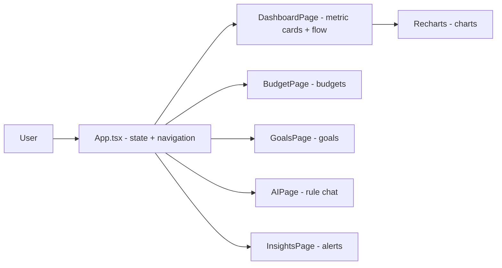

# finvibe-ai

**English** · [Português (Brasil)](README.md)

[](#) [](#) [](#) [](#) [](LICENSE)

## What it is

A **personal finance app** prototype in React with **6 screens** (dashboard, budgets, goals, AI, insights — `cards` is in the type but has no rendered page) and Recharts charts. The "AI" is entirely **rule-based** (`getAIResponse`, keyword matching), deterministic and offline — it calls no LLM. The data is mock, defined in `INITIAL_TRANSACTIONS`, in memory.

## Status

Prototype under development. **Note:** the production build (`npm run build`) fails and lint reports 19 errors — see Tests and quality.

## Features

- **Dashboard**: metric cards (Balance, Income, Savings, Investments, Net worth), cash-flow chart (Recharts) with a 7d/30d filter and a financial score.
- **Budgets**: categories with progress bars.
- **Goals**: goal progress with monthly savings.
- **Financial AI**: chat with deterministic rule-based answers from the mock transactions.
- **Insights**: rule-generated alerts about the data (e.g. "Delivery spike", "Net worth growing", "Yearly projection").
- **Mock transactions**: 5 initial records in memory (`INITIAL_TRANSACTIONS`).

## Architecture

A single `App.tsx` file (1,286 lines) holds all the state, screens and logic in one module, split into page components inside the same file. Navigation is by `currentPage` (state) through a `switch`. There is no router, backend or persistence.



## Stack

- React 19.2, TypeScript ~6.0
- Vite 8, Tailwind CSS 3.4
- Recharts 3.9 (charts), lucide-react (icons)
- ESLint 10 + typescript-eslint

## Repository layout

```
finvibe-ai/
├── src/App.tsx           # the whole app (1,286 lines)
├── src/App.css · index.css
├── src/main.tsx
├── index.html
├── eslint.config.js · tailwind.config.js · postcss.config.js
├── vite.config.ts · tsconfig*.json
└── LICENSE               # MIT
```

## Prerequisites and installation

Node.js (npm).

```bash
git clone https://github.com/KelvinOliveiraCode/finvibe-ai.git
cd finvibe-ai
npm install
```

## How to run

```bash
npm run dev       # development server (Vite)
npm run lint      # eslint (code checks)
npm run build     # production build (tsc -b && vite build)
npm run preview   # preview the build
```

There is no `npm test` script.

## Tests and quality

**Real state verified by the agent (31/10/2026):**

- **`npm run build` FAILS** — the `tsc -b` step reports 8 `TS6133` errors (declared-but-unused values): `Calendar`, `PieChart`, `Pie`, `Cell`, `LineChart`, `Line`, `CATEGORY_ICONS` and `chartData`. The build does not produce a bundle.
- **`npm run lint` returns 19 errors** (e.g. `no-explicit-any`) and exits with code 1.
- There are no automated tests or an `npm test` script.

> The previous README claimed "persistence via localStorage" and React 18. **There is no `localStorage` in the code** (data is mock in memory) and `package.json` uses React 19. Both claims were corrected.

## Technical decisions and trade-offs

- **Everything in one `App.tsx`**: simplicity for a single-page prototype, at the cost of a large file.
- **Rule-based AI instead of an LLM**: offline, free, no API key; in exchange, answers are limited to fixed patterns.
- **In-memory mock data**: no backend or persistence; reloading the page resets changes.

## Known limitations and roadmap

- Build and lint are broken in this state (TS6133 errors / 19 lint errors) — fixing them is the first roadmap step.
- No persistence: adding `localStorage` would make data survive reloads.
- The "cards" page is declared in the type but has no rendered implementation.
- No real banking integration (fictitious data).

## Development process

An individual project by Kelvin Oliveira, built with orchestrated AI agents and reviewed by the author. The screen structure, the Recharts/Tailwind design and the review are the author's.

## License and author

MIT — Copyright (c) 2026 Kelvin Rebelo de Oliveira.

**Author**: [Kelvin Oliveira](https://github.com/KelvinOliveiraCode) · [Portfolio](https://kelvinoliveiracode.github.io/portfolio/)
