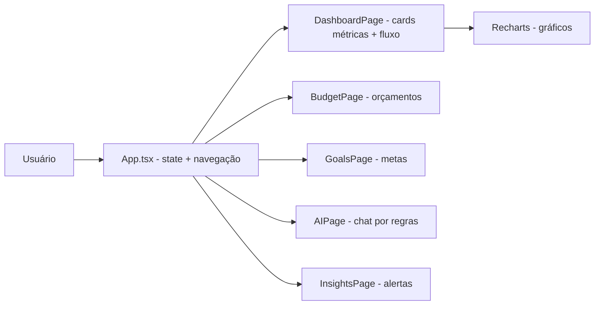

# finvibe-ai

[English](README.en.md) · **Português (Brasil)**

[](#) [](#) [](#) [](#) [](LICENSE)

## O que é

Protótipo de **aplicativo de finanças pessoais** em React com **6 telas** (dashboard, orçamentos, metas, IA, insights — `cards` está no tipo mas não tem página renderizada) e gráficos com Recharts. A "IA" é totalmente **baseada em regras** (`getAIResponse`, matching de palavras-chave), determinística e offline — não chama nenhum LLM. Os dados são mock, definidos em `INITIAL_TRANSACTIONS`, em memória.

## Status

Protótipo em desenvolvimento. **Atenção:** o build de produção (`npm run build`) falha e o lint aponta 19 erros — ver seção Testes e qualidade.

## Funcionalidades

- **Dashboard**: cards de métricas (Saldo, Receitas, Economia, Investimentos, Patrimônio), gráfico de fluxo de caixa (Recharts) com filtro 7d/30d e score financeiro.
- **Orçamentos**: categorias com barras de progresso.
- **Metas**: progresso de metas com economia mensal.
- **IA Financeira**: chat com respostas determinísticas por regras a partir das transações mock.
- **Insights**: alertas gerados por regras sobre os dados (ex.: "Delivery em alta", "Patrimônio crescendo", "Projeção anual").
- **Transações mock**: 5 registros iniciais em memória (`INITIAL_TRANSACTIONS`).

## Arquitetura

Arquivo único `App.tsx` (1.286 linhas) com todo o estado, telas e lógica em um só módulo, dividido em componentes de página dentro do mesmo arquivo. Navegação por `currentPage` (state) com `switch`. Não há roteador, backend nem persistência.



## Stack

- React 19.2, TypeScript ~6.0
- Vite 8, Tailwind CSS 3.4
- Recharts 3.9 (gráficos), lucide-react (ícones)
- ESLint 10 + typescript-eslint

## Estrutura do repositório

```
finvibe-ai/
├── src/App.tsx           # todo o app (1.286 linhas)
├── src/App.css · index.css
├── src/main.tsx
├── index.html
├── eslint.config.js · tailwind.config.js · postcss.config.js
├── vite.config.ts · tsconfig*.json
└── LICENSE               # MIT
```

## Pré-requisitos e instalação

Node.js (npm).

```bash
git clone https://github.com/KelvinOliveiraCode/finvibe-ai.git
cd finvibe-ai
npm install
```

## Como executar

```bash
npm run dev       # servidor de desenvolvimento (Vite)
npm run lint      # eslint (verificações de código)
npm run build     # build de produção (tsc -b && vite build)
npm run preview   # pré-visualiza o build
```

Não há script `npm test`.

## Testes e qualidade

**Estado real verificado pelo agente (31/10/2026):**

- **`npm run build` FALHA** — o passo `tsc -b` aponta 8 erros `TS6133` (valores declarados e nunca usados): `Calendar`, `PieChart`, `Pie`, `Cell`, `LineChart`, `Line`, `CATEGORY_ICONS` e `chartData`. O build não gera o bundle.
- **`npm run lint` retorna 19 erros** (ex.: `no-explicit-any`), e falha com código de saída 1.
- Não há testes automatizados nem script `npm test`.

> O README anterior afirmava "persistência via localStorage" e React 18. **Não há `localStorage` no código** (os dados são mock em memória) e o `package.json` usa React 19. Ambas as alegações foram corrigidas.

## Decisões técnicas e trade-offs

- **Tudo em um `App.tsx`**: simplicidade para um protótipo de uma página, à custa de um arquivo grande.
- **IA por regras em vez de LLM**: offline, gratuita, sem chave de API; em troca, respostas limitadas a padrões fixos.
- **Dados mock em memória**: sem backend nem persistência; recarregar a página zera as mudanças.

## Limitações conhecidas e roadmap

- Build e lint quebrados neste estado (erros TS6133 / 19 lint errors) — primeiro passo do roadmap é resolver.
- Sem persistência: adicionar `localStorage` faria os dados sobreviverem ao reload.
- Página "cards" declarada no tipo, porém sem implementação renderizada.
- Sem integração bancária real (dados fictícios).

## Processo de desenvolvimento

Projeto individual de Kelvin Oliveira, construído com agentes de IA orquestrados e revisado pelo autor. A estrutura de telas, o design com Recharts/Tailwind e a revisão são do autor.

## Licença e autor

MIT — Copyright (c) 2026 Kelvin Rebelo de Oliveira.

**Autor**: [Kelvin Oliveira](https://github.com/KelvinOliveiraCode) · [Portfólio](https://kelvinoliveiracode.github.io/portfolio/)
